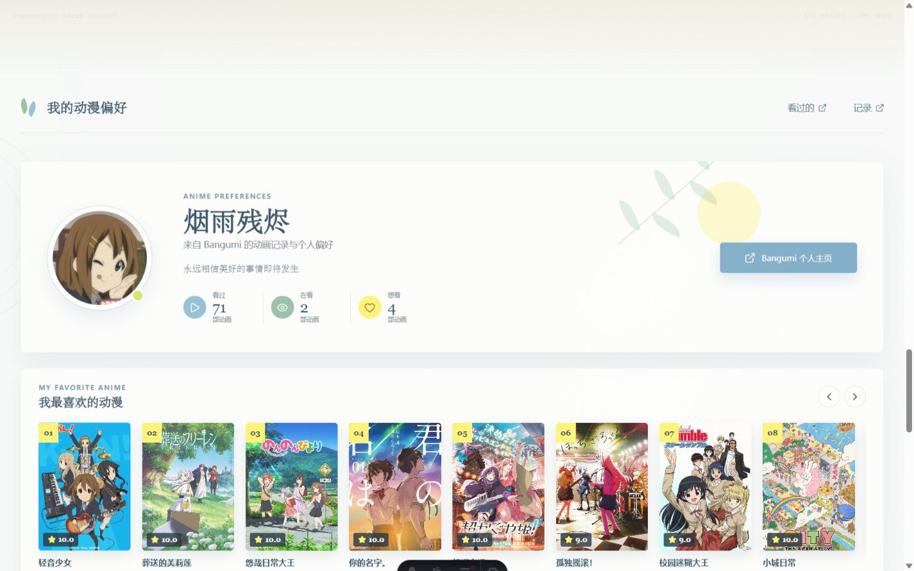
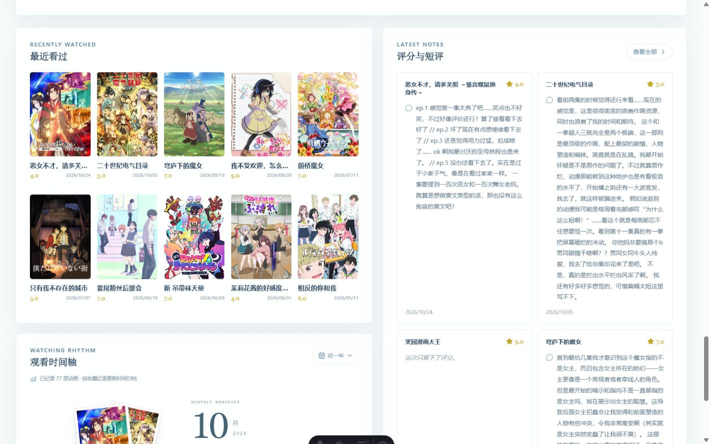
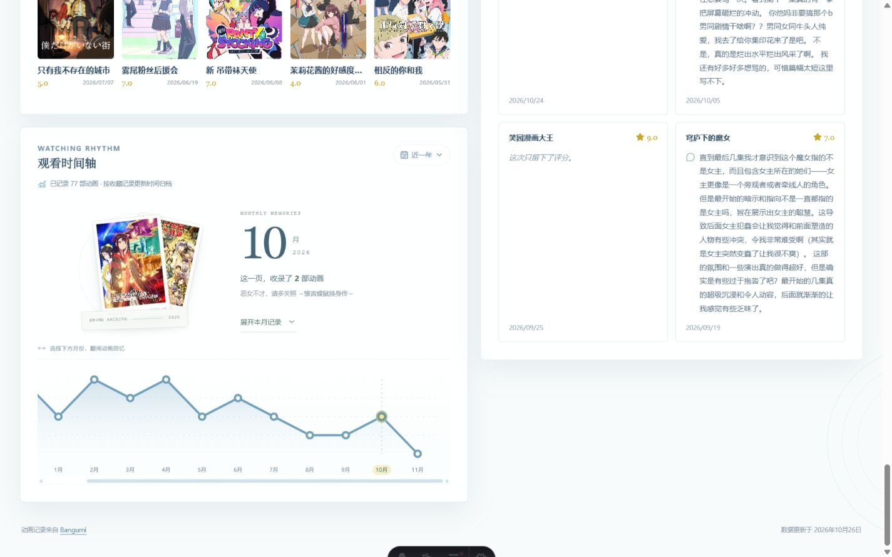
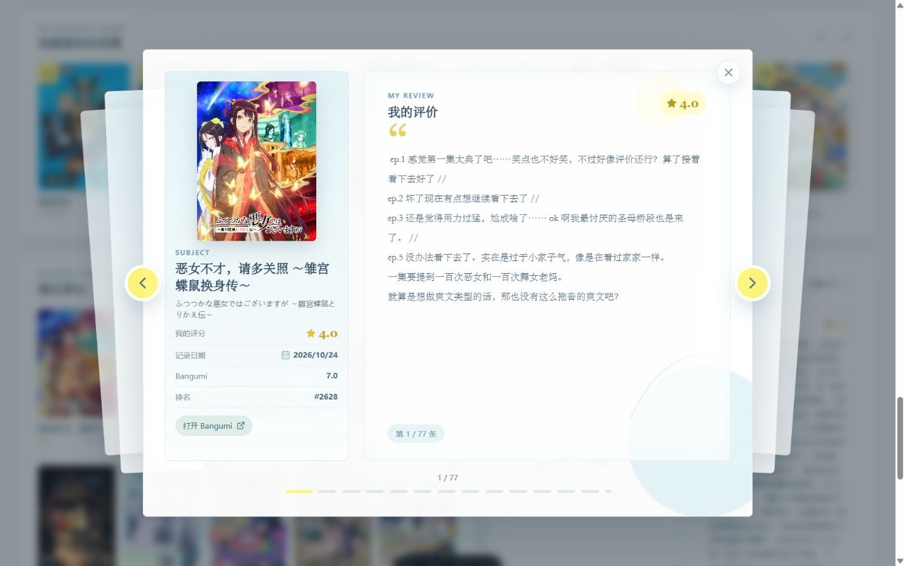
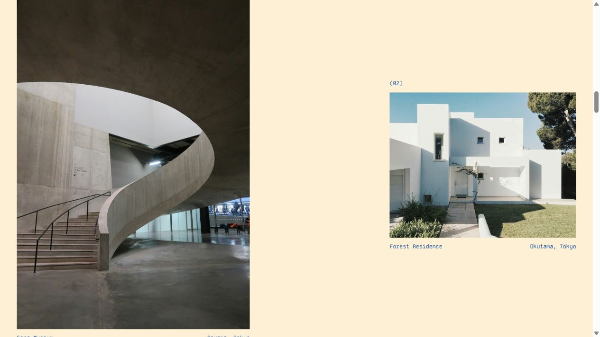
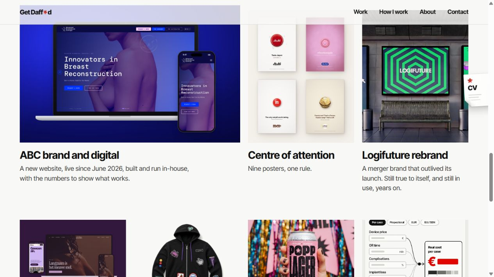
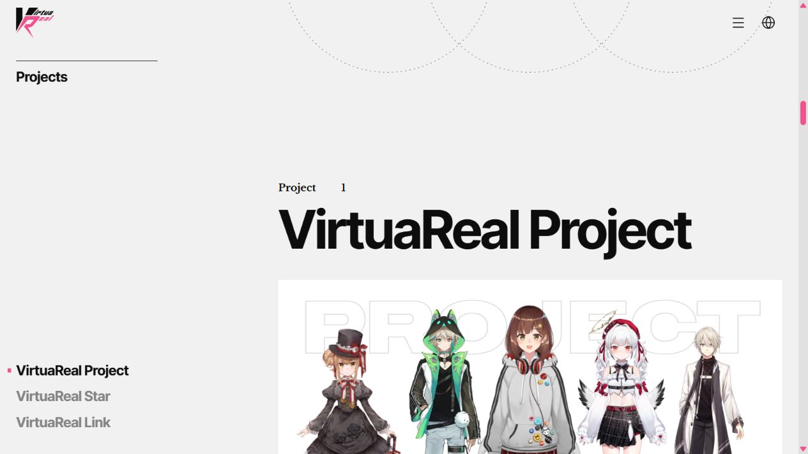
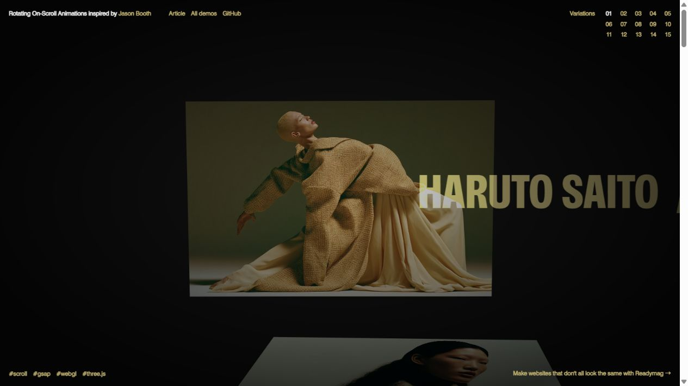
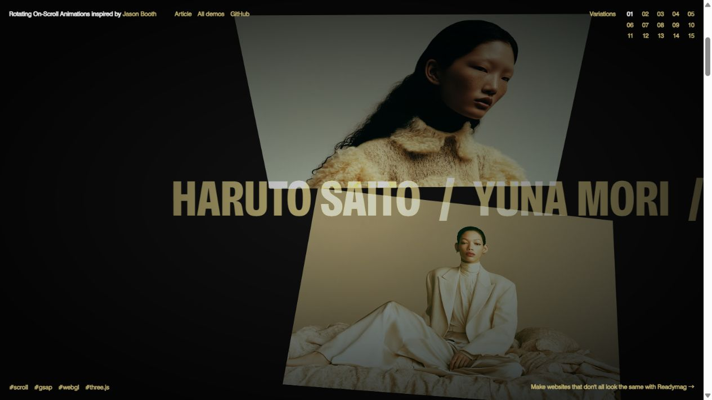

# 信息展示页设计分析与改版建议

审查日期：2026-11-12。依据本次本地运行页面、当前源码，以及用户提供的五个在线参考。信息页按 1440 × 900 桌面视口检查；参考站截图为各自打开时的桌面视口，不能据此直接比较像素尺寸。

**建议把信息展示页组织成一份有主次、有章节的个人动画志。最先调整的是内容同时出现的数量、文字与图片的比例、以及全文的展示层级。** 现有的浅蓝、浅绿、黄色点缀和纸页气质可以继续使用。

本次交付为分析、设计规格与现场截图，未修改页面源码。开幕六幕画廊、最喜欢的动漫光碟子页面均不属于改版对象。下文提到的“收藏入口”仅指信息页上的封面列表及其进入按钮，光碟子页面的布局、素材、角度和交互保持原样。

## 一、现场检查：内容并非过多，而是缺少展示层级

### 01　个人介绍与收藏入口：清晰，但主角不够突出

现有配色协调，头像也有个人辨识度。但个人介绍、收藏、最近记录、短评和时间轴都采用相近的白色面板、边框与阴影，区块之间主要靠约 20–24px 的间距区分。读者容易把它们理解为一组数据模块，难以感受到章节转换。

个人介绍实际高 302px，姓名 42px，各内容区标题为 19px。内容容器在当前视口已经约 1361px 宽，所以“大气感”的欠缺不能靠继续拓宽容器解决。需要让少数重要元素变大，同时降低其余元素的存在感。收藏入口同屏出现约八张等大的封面，排名、评分、中日文名称一起出现，也进一步强化了目录观感。

健康度：基础风格完整；需重建视觉重点。可见阅读风险：英文眉题、辅助文字较小。头像彩蛋可以保留，但不承担主要层级。

### 02　最近看过与短评：当前最需要优先调整

这里存在两层压缩：页面先分成约 724px 与 617px 两栏，左栏又分五列封面，右栏再分两列短评。最近封面实际宽约 123px，长标题被截断；日期字号为 9px，短评正文为 12px。较大的桌面空间最终被切成许多小阅读单元。

更明显的问题是四篇短评直接展示全文。右侧两列网格按同行最长内容确定高度，第一行卡片高约 510px；文字较少的一篇因此留下很大的被动空白。“这次只留下了评分”也会与旁边的长评同高。这类空白来自内容长度失衡，无法帮助读者建立视线顺序。

最近记录与短评还重复出现部分相同作品。用户先看小封面与评分，再去右侧辨认同一标题，才能把作品与评价联系起来。首页更适合让“作品、我的感受、继续阅读”形成一个连续阅读单元。

健康度：优先改造。可见阅读风险：字号小、行宽窄、长文对并排内容产生牵连。应优先调整结构，再增加留白。

### 03　时间轴与月度回忆：已有设计潜力，但被放在次要位置

时间轴里的月份大字、叠放封面和翻阅入口，比普通信息卡更有情绪和辨识度。它却被放在左侧约半页宽的容器内，仍与右侧长评共享版面，视觉上像一个附属统计工具。

建议保留月份切换、回忆叠卡和展开本月记录的功能，让它成为独立的通栏章节。月份与作品应成为主视觉，趋势图负责辅助定位。现有“按收藏记录更新时间归档”说明要继续保留，这些日期不能被改写为准确的看完日期。

健康度：交互构思可保留；需要更大的独立展示空间。可见阅读风险：图表标签、引导文字偏小；本轮未对全部月份与键盘操作逐项验证。

### 04　完整评论弹层：可以承接首页减下来的全文

弹层已经具备较大的封面、集中阅读的正文区、作品信息和前后翻阅。实际检查了打开与关闭，关闭后焦点回到“查看全部”入口。它是首页采用摘要展示的现成基础。

后续让每条摘要提供“阅读全文”，并直接打开对应作品，就能减少首页重复展示全文的必要性。“全部评价”继续保留为完整记录入口。77 条记录逐条翻阅的检索效率可列为后续增强项，不必与这次版式改造捆绑。

健康度：适合复用。正文阅读比首页舒适；尚未完整测试所有条目的切换、长文滚动、焦点循环及屏幕阅读器。

## 二、五个参考分别值得借什么

以下判断来自本次实际浏览；“适合本项目的转化”是设计建议，不是参考站自身的功能说明。

| 参考 | 本次观察到的做法 | 适合本项目的转化 |
| --- | --- | --- |
| [Andres Hunger](https://andreshunger.com/) | 巨大的姓名、强烈的字号反差、章节编号；滚动后进入个人故事和图像片段。 | 让个人身份和章节标题承担构图；小标签作为索引。借尺度关系和叙事顺序，无须沿用其红黑配色与长距离滚动舞台。 |
| [ATELIER NORTH](https://atelier-north.crnacura.workers.dev/) | 大标题与窄正文形成反差，作品图像大小不同、上下错位；图像之间保留整片空白。 | 最适合参考信息页的空间组织。让作品直接放在页面上，用对齐和留白联系内容，减少统一面板包装。 |
| [Get Daffed](https://www.get-daffed.com/) | 首屏用一个显著的图形对象建立记忆点；作品区有明显的“大项带小项”，图像下仅放简洁说明。 | 把最近记录组织为一个主项和少量次项；让一篇代表性记录得到充分空间，其余内容保持轻量。 |
| [用户提供的 VR 参考页面](https://vrp.moe/zh) | 动漫大图建立情绪，随后切换到浅底的大标题、企划章节与角色图；企划区有局部导航。 | 动漫气质可以由图片与内容建立。沿用开幕已建立的情绪，正文用明确章节与本页导航承接，无须再增加一整段重复开场。 |
| [Codrops Rotating On-Scroll Demo 1](https://tympanus.net/Development/RotatingOnScrollAnimations/index.html) | 图像随滚动发生透视旋转，并与横向文字层交错。 | 可给月度回忆的封面加入短暂的翻入或轻旋转；正文和操作按钮保持稳定。此示例适合研究运动方式，不直接承担信息页的整体架构。 |

ATELIER NORTH 的作品编排，可以直观看到“主动留白”的作用：

Dafne 的作品区说明，即使保留多个条目，也可以通过尺寸差异建立阅读顺序：

VR 参考页在正文中用独立章节和角色图像延续动漫气质：

## 三、推荐方案：浅色的个人动画志

推荐继续使用现有纸白、深蓝文字、浅蓝和浅绿，黄色作为少量强调。让头像、动画封面、个人短评和月度回忆成为内容本身的设计语言。全页大量卡片边框和阴影可以撤掉，局部的纸页、收藏入口和交互对象保留触感。

新的阅读顺序如下。尺寸是第一版设计起点，后续需通过实际桌面画面微调；不是已经实现或验证的结果。

| 顺序 | 这一章让访客理解什么 | 版面与默认内容 | 深入入口 |
| --- | --- | --- | --- |
| 原有开幕 | 动漫氛围 | 六幕画廊原样保留。 | 继续原有进入流程。 |
| 01 个人序言 | 这是怎样的一个人 | 约 380–500px 高的开放版面。左侧大姓名和个人短句，右侧头像；统计收成一行小字。 | 本页收藏、最近记录、回忆锚点；Bangumi 为次级外链。 |
| 02 私人收藏 | 哪些作品最能代表你的偏好 | 一个明确的收藏章节标题，展示三张较大封面，形成主次或轻微错落；用“10 部私人收藏”说明总体规模。 | 三张封面分别进入对应光碟；一个清晰的“进入光碟画廊”入口。十部收藏仍完整保留。 |
| 03 最近的观看记录 | 最近看了什么、留下了什么感受 | 默认一个主记录加三个简短次记录。主记录以封面、完整标题、评分和短评摘要配对展示；次记录保持顺序与简短信息。 | 摘要打开对应评价；展开其余最近记录；全部评价继续进入已有弹层。 |
| 04 观看回忆 | 这些动画怎样组成一段时间 | 独立通栏。上部为大月份、叠放封面和月度说明；下部为更轻的月份索引或趋势图。 | 月份切换、时间范围、本月完整记录与已有评价入口。 |
| 收尾 | 去哪里继续了解你 | 一句简短收束、Bangumi 链接和数据更新时间。 | 外部个人主页。 |

### 个人序言：把资料卡改成一段介绍

让“烟雨残烬”成为视觉中心，可从 64–80px 的中文标题尝试；“永远相信美好的事情即将发生”可以获得比现状更高的文字层级。删除与页面整体含义重复的说明，或者将其降为小标签。头像保留原有辨识度与悬停彩蛋。

统计以“看过 71 · 在看 2 · 想看 4”这样的紧凑形式出现，实际值仍从数据读取。“Bangumi 个人主页”作为次级入口，避免成为比站内内容更显眼的主按钮。开幕已经有完整体验，这里无需再追加一个要求停留很久的全屏开场。

### 私人收藏：让光碟子页面获得更有吸引力的入口

主页面不必预先把十部作品的全部字段展示完。可以选原有排序的前三部，使用更大的封面与明显的标题，第一张稍大，另外两张在同一基线附近错开。把“进入光碟画廊”放在清楚的位置，让用户知道后面还有完整收藏。

这一章不再制作第二套光碟场景。它负责邀请进入，现有光碟子页面负责完整体验。入口需要继续传递正确的作品索引，并在关闭光碟后回到原入口与浏览位置。

### 最近记录：一部作品与一段感受一起出现

这是本次最值得优先试做的区块。推荐主项采用“左图、右文”，封面宽约 240–300px；次项采用较小的图文条目。不同层级采用不同版式，避免再形成均匀的两列长评卡片。

主项默认按现有最近记录顺序选择，评分低也照实呈现，标签明确写“最近记录”。不要因为视觉上放大，就把它包装成推荐作品。摘要从真实评论摘取约 80–120 个中文字或 3–4 行，保留“阅读全文”；没有评论时只显示评分和日期，不占用一张高大的空评论卡。

首页默认展示四条，但原有十条最近记录应能通过展开继续查看。所有评价仍能从既有弹层进入。封面与评论按作品 ID 关联，避免最近记录与最近评价排序不同造成错配；“阅读全文”始终打开当前作品。

数据语义也需要保持准确：当前最近记录包含“看过”和“抛弃”，时间依据是收藏更新时间。设计文案可以使用“最近的观看记录”，但不能暗示所有条目都已完整看完，也不能将更新时间解释为实际完结观看日期。

### 观看回忆：把已经有特色的部分提升为一个章节

扩大现有叠卡和月份的展示尺寸，保留翻阅的亲切感。月份数字可从 80–112px 尝试，封面宽约 180–220px；趋势图作为下方的辅助导航，不与视觉主体争抢注意力。

完整的月度作品列表仍按需展开。这一章可以用略带浅蓝或浅绿的整块背景与上一章区分，而不必再包进一个带厚阴影的白卡片。原有时间范围、空月份和记录条目功能都要保留。

## 四、排版与动效的具体规格

### 空间与文字

| 项目 | 第一版建议 | 意图 |
| --- | --- | --- |
| 内容宽度 | 桌面正文约 1200–1320px，结合视口保留约 5–7vw 侧边空间 | 现状已经很宽，优先改善内部组织。图像章节可局部突破正文边界。 |
| 章节间距 | 约 96–144px，按内容相邻关系调整 | 让读者感到换章；不是给每张卡片机械加大 margin。 |
| 姓名 | 64–80px 起步 | 建立身份与首要视觉焦点。 |
| 章节标题 | 36–48px 起步 | 拉开与元信息的层级。中文控制行长，不照搬英文巨字比例。 |
| 正文与摘要 | 16–18px，行高约 1.7–1.9 | 支持正常桌面阅读。 |
| 日期、标签 | 12–14px | 保持次级但可读；减少 9–10px 的有效信息。 |
| 正文宽度 | 中文每行约 25–36 字 | 控制长行；不把文字横向铺满整个屏幕。 |
| 阴影与边框 | 主要留给可操作对象和少量纸页层次 | 页面章节通过空间、标题和色块识别。 |

保留内容尺度的变化，但不要让每一章都占满一屏，也不要把所有章的留白都做成一样。总阅读节奏应有舒展、聚焦、短暂停留和收束。

### 动效

信息页已有进入视口动画、头像彩蛋、封面反馈、月度回忆和评论翻页。新增动效应服务于重点转换：章节标题轻移出现，封面随滚动短暂转正，切换月份时叠卡轻微交接。每一时刻尽量只有一个主要运动对象。

Codrops 可参考的是透视旋转与图像交接：

适合本页的首轮参数是约 4–8° 的轻旋转、20–40px 的位移、0.5–0.8 秒的进入过程。这些只是拟定起点。正文保持水平和稳定，不让长评逐字等待解锁；避免将每一章都改成多屏固定滚动舞台。现有开幕和光碟已经提供较强的运动体验。

减少动态效果时，信息页直接呈现最终布局；鼠标悬停不能成为查看关键内容的唯一方式。移动端取消需要大横向空间的错位结构，使用正常单列顺序和明确按钮。页面性能、移动端手感与减少动态效果的实际表现需要在实现后验证。

## 五、落地顺序与代码边界

第一步先改“最近记录与短评”，用真实的长标题、最长短评和无评论条目验证摘要布局。第二步重排个人介绍和独立时间轴。第三步优化收藏入口并统一字号、间距和背景节奏。静态画面成立后，再添加一处主要滚动动效。

| 现有文件 | 计划承担的变化 | 需要保留的边界 |
| --- | --- | --- |
| `src/components/RecentSections.astro` | 将最近记录与摘要配对；将完整评价弹层与首页排列解耦。 | 现有作品 ID、完整评价数据、打开关闭与翻页能力。 |
| `src/components/ProfileHero.astro` | 开放式介绍、姓名层级和紧凑统计。 | 用户资料、头像、真实统计及外链。 |
| `src/components/WatchTimeline.astro`、`src/styles/watch-timeline.css` | 将月度回忆提升为通栏章节，调整主视觉和图表比例。 | 月份选择、范围切换、展开记录及评价关联。 |
| `src/pages/index.astro` | 重新组织章节顺序与数据传递。 | `DepthGallery` 本身和进入主页的衔接契约。 |
| `src/components/FavoriteRail.astro` | 仅调整信息页的收藏入口部分。 | 同文件中的光碟 `<dialog>` 与相关运行逻辑应保持原样，不能整文件重写。 |
| `src/styles/global.css`、`src/styles/home-motion.css`、`src/scripts/home-motion.ts` | 重建信息页排版与局部反馈。 | 用组件级范围控制样式，避免全局字号、变量和选择器误伤画廊或光碟。 |

现有 Astro、TypeScript、CSS 和数据快照足够支持这次调整，无须为版式重组增加数据库、SSR 或新的前端框架。第一版也不需要为了引用 Codrops 而立即引入一套额外动画依赖。

实施时有一个细节值得顺手核对：部分 `home-motion.css` 收藏封面选择器仍是 `.favorite-card a`，而当前收藏入口使用 `button`；新的动效应以实际节点为准，避免写入了变量却没有对应的样式生效。这个问题不影响本次关于密度与层级的判断。

## 六、后续验收方式

设计上，进入信息页后应能立即辨认个人身份与主要内容入口；最近记录区第一眼只需要处理一个重点和少量次项；完整短评通过明确的按钮继续阅读。新旧对照要使用相同数据与视口，尤其关注当前长评导致的等高空白是否消失。

实现后重点检查 1366、1440、1920 宽桌面以及一档手机宽度，验证长中文标题、无评论、少量记录、空月份、展开列表、对应评价打开、光碟关闭返回、键盘焦点与减少动态效果。优先观察布局和交互，不为纯视觉变化添加大量机械单元测试。

本轮只完成桌面观察、源码核对、评论弹层打开关闭及参考站滚动检查；没有进行完整移动端、缩放、屏幕阅读器、性能帧率或 WCAG 合规评估。所有拟定尺寸、内容数量和动画参数均属于待实现验证的设计建议。

## 截图与证据索引

全部图片均在本次任务中采集并检查，未使用仓库里的历史效果图作为现状证据。浏览器测量保存在 [measurements.json](measurements.json)。

| 编号 | 内容 | 截图 |
| --- | --- | --- |
| 01 | 当前个人介绍与收藏入口 | [查看原图](screenshots/01-current-overview.jpg) |
| 02 | 当前最近记录与短评 | [查看原图](screenshots/02-current-content.jpg) |
| 03 | 当前月度回忆与时间轴 | [查看原图](screenshots/03-current-timeline.jpg) |
| 04 | 当前完整评论弹层 | [查看原图](screenshots/04-current-review-dialog.jpg) |
| 11 | Andres 首屏字号与构图 | [查看原图](screenshots/11-andres-hero.jpg) |
| 12 | ATELIER NORTH 首屏 | [查看原图](screenshots/12-atelier-hero.jpg) |
| 13 | ATELIER NORTH 错落作品图 | [查看原图](screenshots/13-atelier-projects.jpg) |
| 14 | Andres 个人故事滚动章节 | [查看原图](screenshots/14-andres-scroll.jpg) |
| 15 | Dafne 首屏主视觉 | [查看原图](screenshots/15-daffed-hero.jpg) |
| 16 | Dafne 作品主次布局 | [查看原图](screenshots/16-daffed-work.jpg) |
| 17 | VR 动漫主视觉 | [查看原图](screenshots/17-vr-hero.jpg) |
| 18 | VR 使命章节滚动中间态 | [查看原图](screenshots/18-vr-mission.jpg) |
| 19 | Codrops 初始状态 | [查看原图](screenshots/19-codrops-before.jpg) |
| 20 | Codrops 旋转中间态 | [查看原图](screenshots/20-codrops-rotating.jpg) |
| 21 | VR 企划章节 | [查看原图](screenshots/21-vr-project.jpg) |
